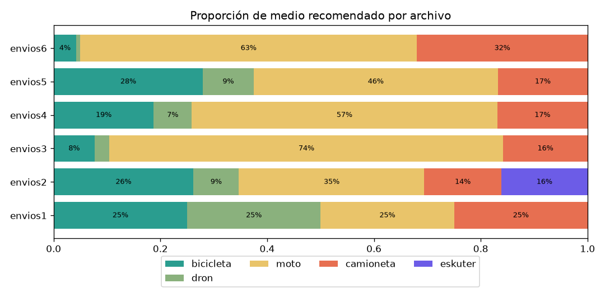
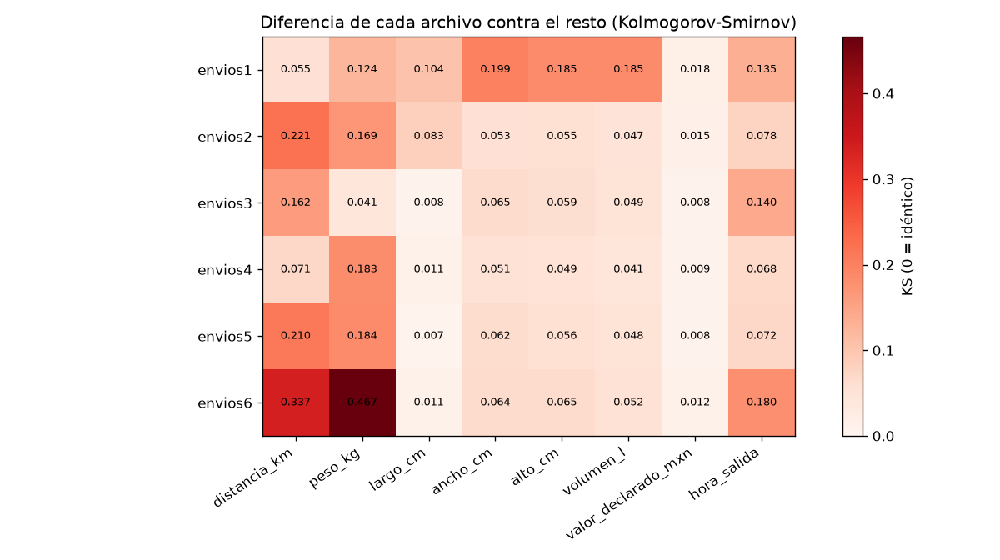
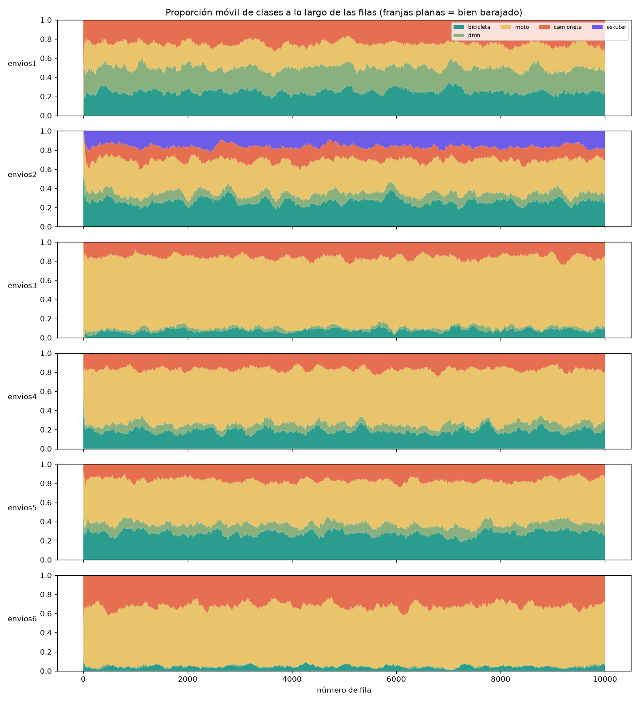

# Análisis de envios-data

**Nombre:** Rodrigo Vega Espinoza
**Matrícula:** 22121334

Seis archivos (`envios1.csv` … `envios6.csv`) de 10,000 envíos cada uno, con las mismas columnas que el dataset de clase. La idea es ver qué tan distintos son entre sí y qué pasa cuando el árbol de decisión de la plataforma (`modelo_medios.joblib`) los tiene que predecir.

## Archivos de esta carpeta

| Archivo | Qué es |
|---|---|
| `datos/envios1-6.csv` | Los seis archivos |
| `analizar_envios.py` | Mi script de análisis: calidad de datos, proporciones, KS, rachas, gráficas |
| `resultados_envios/` | Las 9 gráficas y `resumen.txt` que genera el script |
| `evaluar_modelo.py` | Prueba el `.joblib` contra cada archivo |
| `resultados_modelo.txt` | Salida completa de la prueba del modelo |

```
python analizar_envios.py datos resultados_envios
python evaluar_modelo.py ruta/a/modelo_medios.joblib datos
```

---

## 1. Lo que encontré en los datos

### Calidad

- Los seis archivos tienen 10,000 filas, cero nulos y cero filas duplicadas.
- **Los seis usan los mismos ids** (`ENV-000001` a `ENV-010000`), pero ningún registro es idéntico entre archivos. O sea, el id no sirve para unirlos: el mismo `ENV-000001` es un envío distinto en cada archivo.
- El volumen siempre cuadra con largo × ancho × alto.
- Hay 2,664 valores declarados arriba de 6,130 MXN, con un máximo de 80,000. Son atípicos, pero no imposibles.

### Proporción de medios



| Archivo | Bicicleta | Dron | Moto | Camioneta | Eskuter |
|---|---|---|---|---|---|
| envios1 | 25.0% | 25.0% | 25.0% | 25.0% | — |
| envios2 | 26.2% | 8.6% | 34.7% | 14.4% | **16.2%** |
| envios3 | 7.7% | 2.8% | 73.7% | 15.8% | — |
| envios4 | 18.8% | 7.1% | 57.2% | 16.9% | — |
| envios5 | 28.0% | 9.5% | 45.8% | 16.8% | — |
| envios6 | 4.2% | 0.7% | 63.1% | 32.0% | — |

- `envios1` está balanceado a mano: 2,500 de cada uno. No parece una muestra real, sino un sobremuestreo.
- `envios2` trae un medio nuevo, `eskuter`, que el modelo no conoce.
- `envios3` y `envios6` están cargados a moto; en `envios6` casi no hay drones.

### ¿Vienen de la misma distribución?



Comparé cada archivo contra el resto con el estadístico KS (0 = igual, más de 0.10 = distinto):

- **`envios6` es el más distinto**: KS de 0.34 en distancia y 0.47 en peso. Son viajes más largos y paquetes más pesados, y eso explica que tenga 32% de camioneta.
- `envios2` y `envios5` también se van en distancia (0.22 y 0.21).
- `envios1` se aleja en las medidas (ancho y alto, alrededor de 0.19). Eso cuadra con un archivo balanceado artificialmente: al forzar 25% de dron y bicicleta, se meten más paquetes chicos.
- Las medidas y el valor declarado son casi iguales en todos (KS menor a 0.02 en valor declarado).

### Orden de las filas



La racha media de la misma clase va de 1.3 a 2.3. Eso es casi lo de un archivo barajado (alrededor de 1.4), así que ninguno viene ordenado por medio. `envios3` y `envios6` dan rachas un poco más largas solo porque la moto es tan común que sale seguida por pura probabilidad.

### Reglas que se ven en los datos

- **Refrigerado = 1 → siempre camioneta** (5,820 de 5,820).
- **Dron nunca con lluvia ni con viento fuerte**, solo con cielo despejado.
- **Bicicleta nunca a zona rural** y casi nunca a la periferia (137). Su distancia máxima es 7 km y su peso máximo 8 kg.
- **Dron casi nunca a rural** (63) y nunca al centro. Su peso máximo es 2.5 kg y su distancia máxima 15 km.
- El `eskuter` queda en medio: hasta 20 km y 12 kg, sin refrigerado, nunca rural ni con viento fuerte. Por perfil se parece mucho a la moto.

---

## 2. Predicción (antes de correr el modelo)

1. **`envios2` va a ser el peor**, porque el 16.2% de sus filas es `eskuter` y el modelo nunca podrá responder esa etiqueta. La exactitud no debería pasar de alrededor de 83%.
2. **Los `eskuter` se van a ir casi todos a moto**, porque su perfil (distancia, peso y zonas) es el más cercano a ella.
3. **`envios6` va a bajar respecto a los demás** por ser el más alejado en distancia y peso. Creo que va a quedar por debajo de `envios3` y `envios4`.
4. **El dron va a tener el peor f1** en casi todos los archivos, porque es la clase con menos ejemplos y además depende de la hora y del clima.
5. **En `envios1` la exactitud va a bajar** comparada con los archivos cargados a moto, porque ahí el 50% son dron y bicicleta, que son las clases más difíciles.
6. **El modelo siempre va a superar a responder "moto"**, salvo quizá en `envios3`, donde la moto ya es 73.7%.

---

## 3. Resultados con el árbol (`modelo_medios.joblib`)

Salida completa con las matrices de confusión en [`resultados_modelo.txt`](resultados_modelo.txt).

| Archivo | Exactitud | Responder siempre la mayoritaria | f1 más bajo |
|---|---|---|---|
| envios1 | 95.37% | 25.0% | dron 0.900 |
| envios2 | **77.66%** | moto 34.7% | eskuter 0.000, después moto 0.776 |
| envios3 | 94.49% | moto 73.7% | dron 0.747 |
| envios4 | 92.69% | moto 57.2% | dron 0.838 |
| envios5 | 92.52% | moto 45.8% | dron 0.842 |
| envios6 | **96.15%** | moto 63.1% | dron 0.685 |

### Errores que más se repiten

- **Dron → bicicleta.** En `envios1` se van 453 drones a bicicleta, y nunca al revés. El modelo acierta todas las bicicletas, pero "se roba" drones.
- **Moto → dron.** Aparece en todos los archivos (117 a 145 por archivo, 43 en `envios6`). Por eso la precisión del dron baja tanto en los archivos con pocos drones: en `envios6` hay 61 aciertos contra 43 motos mal etiquetadas como dron (precisión 0.58).
- **Camioneta → moto.** Entre 96 y 210 por archivo. La camioneta casi nunca se predice mal hacia otro lado (precisión de 0.99 a 1.00), pero se le escapan casos hacia moto.
- **`eskuter`:** de 1,616, 1,405 se predicen como moto (87%), 177 como bicicleta y 34 como dron.

### Hallazgo extra: `envios5` es casi el dataset de clase

`envios5` tiene exactamente los mismos conteos que `envios_medios.csv` (4,578 moto, 2,796 bicicleta, 1,678 camioneta, 948 dron), y **9,041 de sus 10,000 filas son idénticas** a las del dataset con el que se entrenó el árbol. O sea, ese archivo no es una prueba justa, porque el modelo ya vio el 80% de esas filas al entrenar. Aun así solo saca 92.5%, casi lo mismo que el 92.1% del conjunto de prueba en clase. Eso indica que el árbol con `max_depth=8` no memoriza: el error que queda viene del ruido en las etiquetas, no de falta de entrenamiento.

---

## 4. ¿Acerté?

| # | Predicción | Resultado |
|---|---|---|
| 1 | `envios2` el peor, menos de 83% | ✅ 77.66%. Fue el único abajo de 92%. |
| 2 | Los `eskuter` se van a moto | ✅ 87% a moto. Tiene sentido: es la clase con el perfil más cercano. |
| 3 | `envios6` baja por ser el más distinto | ❌ **Fue el mejor (96.15%).** Lo distinto de `envios6` son viajes más largos y paquetes más pesados, y esos son justo los casos fáciles: camioneta o moto, sin ambigüedad. Que un archivo esté "lejos" en KS no lo hace difícil; importa hacia dónde se movió. |
| 4 | El dron con el peor f1 | ✅ En 5 de 6. En `envios2` el peor es el `eskuter` (0) y después la moto, que recibe todos los `eskuter`. |
| 5 | `envios1` baja por tener 50% de dron y bicicleta | ❌ Sacó 95.37%, segundo lugar. Camioneta y moto salen casi perfectas y la bicicleta tiene recall de 1.0. Lo único que falla es dron → bicicleta. |
| 6 | Siempre supera a "siempre moto" | ✅ En todos, incluso en `envios3` (94.5% contra 73.7%). |

## 5. Conclusiones

1. **La exactitud sola engaña.** `envios6` da 96% y `envios3` 94.5%, pero el dron en esos archivos tiene precisión de 0.58 y 0.63: casi la mitad de las veces que el modelo dice "dron", se equivoca. Si la plataforma manda drones con esa confianza, falla mucho más de lo que dice la cifra global.
2. **Un medio que el modelo no conoce no se puede predecir, y el modelo no avisa.** Los `eskuter` salen como moto con toda seguridad. Si se agrega un medio nuevo, hay que reentrenar; mientras tanto, las reglas (`reglas.py`) son las que deben decidir si se permite.
3. **Que el archivo sea distinto no significa que sea más difícil.** Me equivoqué con `envios6` por pensar solo en el KS. Hay que ver si el cambio empuja los datos hacia zonas fáciles o hacia las fronteras entre clases (dron/bicicleta, moto/dron).
4. **Antes de evaluar hay que revisar que los datos de prueba no sean los de entrenamiento.** `envios5` habría parecido una buena prueba si no comparo filas.
5. **Los errores son siempre los mismos pares** (dron/bicicleta, moto/dron, camioneta/moto). Son fronteras que dependen de la hora, el clima y el peso, y ahí conviene que las reglas corrijan al modelo en vez de confiar en él.
