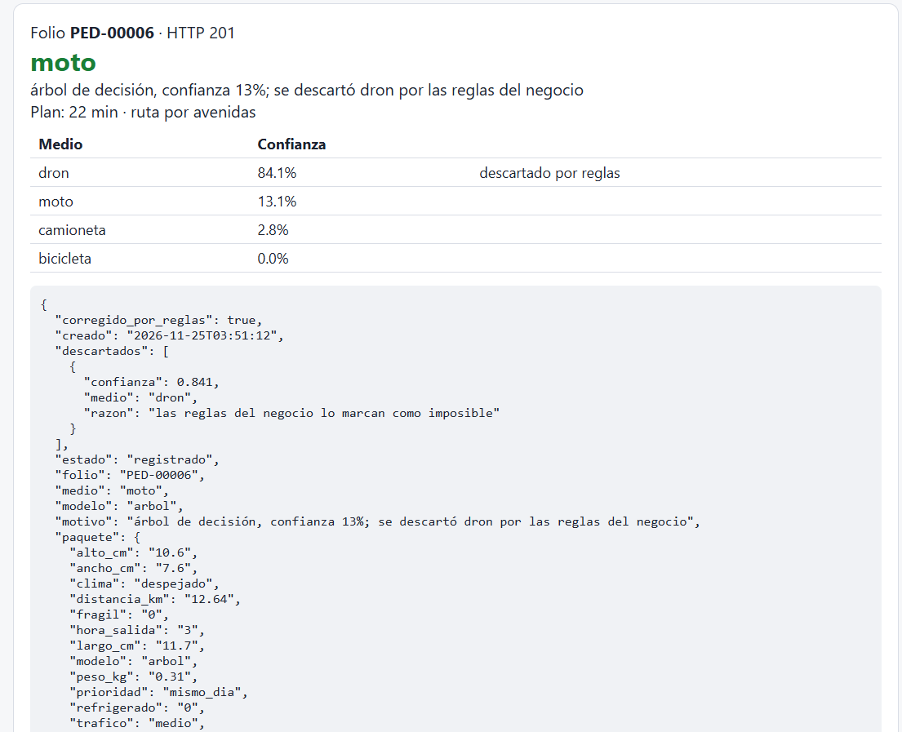

# Actividad — Microservicios con Docker

**Nombre:** Rodrigo Vega Espinoza
**Matrícula:** 22121334
**Equipo:** 3

Código: [`microservicios-entregas/`](../../microservicios-entregas/). Las salidas completas de las pruebas están en [`microservicios-entregas/evidencias/`](../../microservicios-entregas/evidencias/).

Paquete de prueba (`paquete.json`): 12.64 km · 0.31 kg · 11.7 × 7.6 × 10.6 cm (0.94 L) · no frágil · no refrigerado · $4,603 · mismo día · periferia · despejado · **hora_salida = 3** · tráfico medio.

---

## 1. Predicción (hora 3) vs resultado

**Predicción.** En mi Django ya había visto que el árbol prefiere **dron** para este paquete. Como el servicio `recomendar` usa el mismo `.joblib` y el mismo `reglas.py`, esperaba que el resultado fuera idéntico: el dron descartado por la regla de noche (`hora_salida < 6`) y **moto** como medio final. Lo único que debía cambiar era el camino: ahora pasa por el gateway y por dos servicios.

**Resultado en el navegador (árbol):** folio `PED-00006` (los folios 1 a 5 se crearon antes con `curl`), **moto**, "árbol de decisión, confianza 13%; se descartó dron por las reglas del negocio".

| Medio | Confianza | |
|---|---|---|
| dron | 84.1% | descartado por reglas |
| moto | 13.1% | ← elegido |
| camioneta | 2.8% | |
| bicicleta | 0.0% | |

Plan: 22 min, ruta por avenidas.



**Comparación:** se cumplió exactamente. Separar en servicios no cambia la decisión, porque el modelo y las reglas son los mismos archivos; cambia por dónde viaja la petición.

---

## 2. `docker compose ps`

```
NAME                                   IMAGE                                SERVICE      STATUS         PORTS
microservicios-entregas-gateway-1      nginx:1.27-alpine                    gateway      Up 8 seconds   0.0.0.0:8080->80/tcp
microservicios-entregas-pedidos-1      microservicios-entregas-pedidos      pedidos      Up 9 seconds   5000/tcp
microservicios-entregas-recomendar-1   microservicios-entregas-recomendar   recomendar   Up 9 seconds   5001/tcp
```

Solo el gateway publica un puerto hacia mi máquina (8080). `pedidos` y `recomendar` solo son alcanzables dentro de la red de Compose, por nombre de servicio.

---

## 3. ¿Qué pasó al detener `recomendar`?

```
$ docker compose stop recomendar
$ curl -X POST localhost:8080/pedidos --data-binary @paquete.json
{"estado":"pendiente_de_medio","folio":"PED-00004","medio":null,
 "aviso":"recomendar no disponible (ConnectionError); el pedido quedó registrado sin medio", ...}
HTTP 202  tiempo 7.85s
```

- **Pedidos siguió vivo.** `/salud/pedidos` respondió 200 y el pedido viejo `PED-00002` se pudo consultar sin problema.
- El pedido nuevo **se registró sin medio**, con estado `pendiente_de_medio` y HTTP 202. No se inventó un medio ni hubo error 500.
- `/salud/recomendar` en el gateway respondió **504**.
- Al hacer `docker compose start recomendar`, el siguiente pedido (`PED-00005`) volvió a salir `registrado` con moto.

**Lo que no esperaba:** la respuesta tardó **7.85 s**, aunque puse `timeout=3`. Lo medí dentro del contenedor: resolver el nombre `recomendar` cuando el contenedor está detenido tarda **4 s** solo en el DNS de Docker antes de fallar, y `requests` no cuenta ese tiempo dentro del timeout. Si `recomendar` cae de verdad, cada pedido se queda varios segundos esperando. Esto se arregla con un circuit breaker o un timeout total de la operación (ver punto 7).

---

## 4. Réplicas vs esto

Con las réplicas de la ruta de Django (`web` ×3 detrás de nginx), las tres copias son **la misma aplicación completa**: cada una trae vistas, pedidos, modelo y reglas. Sirven para repartir carga y para que, si se cae una copia, las otras atiendan. Pero un modelo roto se rompe en las tres a la vez, y para cambiar el `.joblib` hay que reconstruir todo Django.

Aquí hay **tres programas distintos**, cada uno con una responsabilidad: el gateway enruta, pedidos registra y recomendar predice. Detener `recomendar` no tumbó a pedidos (punto 3), algo que con réplicas del monolito no se puede hacer, porque no existe un "pedazo" del monolito que se pueda apagar. Las dos ideas se combinan: se pueden escalar solo las réplicas de `recomendar` (`docker compose up --scale recomendar=3`) sin duplicar pedidos.

---

## 5. Camino del navegador al modelo (red vs import)

```
Navegador
  └─HTTP POST /pedidos──────────► gateway (nginx :80 → host :8080)       [red 1: host → contenedor]
       └─proxy_pass─────────────► pedidos:5000  app.crear_pedido()       [red 2: gateway → pedidos]
            └─requests.post─────► recomendar:5001  app.sugerir()         [red 3: pedidos → recomendar]
                 └─ import ─► ia.recomendador.obtener_recomendador("arbol").explicar(paquete)
                                 └─ import ─► ia.reglas.es_posible(...)
            ◄──JSON (medio, ranking, descartados)
            └─ import ─► medios.crear_medio("moto").planear(...)
  ◄──JSON con folio y plan
```

En Django todo después del navegador era `import`: `views.recomendar` → `recomendador` → `reglas` → `medios`, en el mismo proceso. Ahora hay **tres saltos de red**, y cada uno puede fallar por su cuenta (timeout, DNS, 504). Dentro de cada servicio sigue habiendo `import`: la frontera de red quedó justo entre "registrar el pedido" y "predecir el medio".

---

## 6. Si solo cambia el `.joblib`, ¿qué se reconstruye?

Solo **`recomendar`**:

```bash
cp nuevo_modelo.joblib recomendar/ia/modelo/modelo_medios.joblib
docker compose up -d --build recomendar
```

El `Dockerfile` de recomendar hace `COPY . .`, así que el modelo vive dentro de su imagen (513 MB, por scikit-learn, pandas y numpy). `pedidos` (136 MB, sin scikit-learn) y el gateway (nginx, 48 MB) no se tocan ni se reinician. Mientras recomendar arranca, pedidos responde `pendiente_de_medio` en vez de caerse.

Una condición: el modelo nuevo debe estar entrenado con **la misma versión de scikit-learn** fijada en `recomendar/requirements.txt` (1.9.0). Si no, `joblib.load` puede fallar o dar resultados raros.

---

## 7. Dos límites antes de producción

1. **Los pedidos viven en memoria.** `_pedidos` es un diccionario dentro del proceso de pedidos. Si el contenedor se reinicia, se pierden todos los folios, y por eso lo dejé con 1 worker (con más, cada worker tendría su propia lista). Para producción se necesita una base de datos (Postgres) con su volumen, igual que en la ruta de Django.
2. **La espera cuando recomendar está caído.** Cada pedido tardó 7.85 s (punto 3). Hace falta un **circuit breaker**: después de N fallos seguidos, pedidos deja de intentar durante un rato y responde `pendiente_de_medio` al instante. También falta un proceso que recorra los pedidos pendientes cuando recomendar regrese y les asigne medio.

Otros que noté: no hay autenticación en el gateway, `POST /pedidos` no es idempotente (un doble clic crea dos folios) y no hay HTTPS.

---

## 8. ¿Cómo se compara el HTML con el de Django?

| | Django (`entregas/recomendar.html`) | Gateway (`gateway/html/index.html`) |
|---|---|---|
| Quién lo sirve | Django lo **renderiza** con plantilla | nginx lo sirve como **archivo estático** |
| Lista de modelos | Viene de `modelos_disponibles()` y desactiva los que no tienen `.joblib` | Escrita a mano en el HTML (árbol / bosque / red) |
| A dónde hace `fetch` | `POST /entregas/recomendar/` (mismo Django) | `POST /pedidos` (el gateway lo manda a pedidos) |
| Qué regresa | Recomendación + los 6 pasos del `proceso` | **Folio** + medio, ranking, descartados y plan |
| Si falla la IA | 503 del mismo servidor | El pedido se guarda igual (202) y se muestra el aviso |
| Extra | — | Indicador de salud de pedidos y recomendar |

La página nueva no sabe nada del modelo: solo conoce `/pedidos` y `/salud/*`. Eso deja cambiar o mover `recomendar` sin tocar el HTML. Lo que perdí es la lista dinámica de modelos: si agrego uno, tengo que editar el HTML. Se resolvería exponiendo `GET /modelos` por el gateway.

---

## 9. El mismo paquete (hora 3) con árbol, bosque y red

| Modelo | Folio | Preferido por el modelo | ¿Reglas corrigieron? | Medio final | Motivo |
|---|---|---|---|---|---|
| árbol | PED-00001 | dron 84.1% | **Sí** (dron de noche) | moto | árbol de decisión, confianza 13%; se descartó dron por las reglas del negocio |
| bosque | PED-00002 | moto 81.0% (dron 17.3%) | No | moto | random forest, confianza 81% |
| red | PED-00003 | moto 98.3% (dron 1.6%) | No | moto | red neuronal, confianza 98% |

**El medio no cambió** (siempre moto), pero **el motivo sí**, y mucho. El árbol se equivoca de noche: corta por rangos de hora y no capta bien que "3:00" es de noche, así que manda dron con 84%, y solo las reglas lo salvan, dejando moto con una confianza de 13%. El bosque, al promediar muchos árboles, ya prefiere moto, aunque aún le da 17% al dron. La red casi descarta el dron sola. Esto muestra por qué las reglas tienen que vivir junto al modelo en `recomendar`: con el árbol, sin `reglas.py`, el pedido habría salido en un dron de madrugada.
