# Flutter: fundamentos, instalación y widgets

**Nombre:** Rodrigo Vega Espinoza
**Matrícula:** 22121334

Hice una sola app de práctica (`app/`) con un menú y una pantalla por cada widget de la clase. Los datos son de una tienda de **artículos deportivos** (mi dominio del proyecto): pedidos con folio `DEP-000X`, balones, raquetas, bicicletas.

```bash
cd app
flutter pub get
flutter run -d chrome          # o: flutter run -d windows
flutter test                   # 3 pruebas
flutter analyze                # sin problemas
```

Cada pantalla se puede abrir directo en web: `http://localhost:PUERTO/#/contador`, `#/lista`, `#/alerta`, etc.

| Archivo | Qué tiene |
|---|---|
| `lib/main.dart` | `MaterialApp`, el menú y las rutas |
| `lib/pantallas.dart` | Una clase por práctica |
| `lib/datos.dart` | Los pedidos de prueba |
| `test/widget_test.dart` | Pruebas del menú, del contador y del overflow de `Row` |

---

## Instalación

Flutter está instalado en `C:\src\flutter`. `flutter devices` encuentra **Windows (desktop)**, **Chrome** y **Edge**. Creé el proyecto con:

```bash
flutter create --project-name fundamentos_flutter --platforms web,android --org mx.itm.rvega app
```

Antes de cambiar el código lo compilé tal cual: aparece el contador de demo que trae `flutter create`, lo que confirma que el SDK y la compilación a web funcionan.

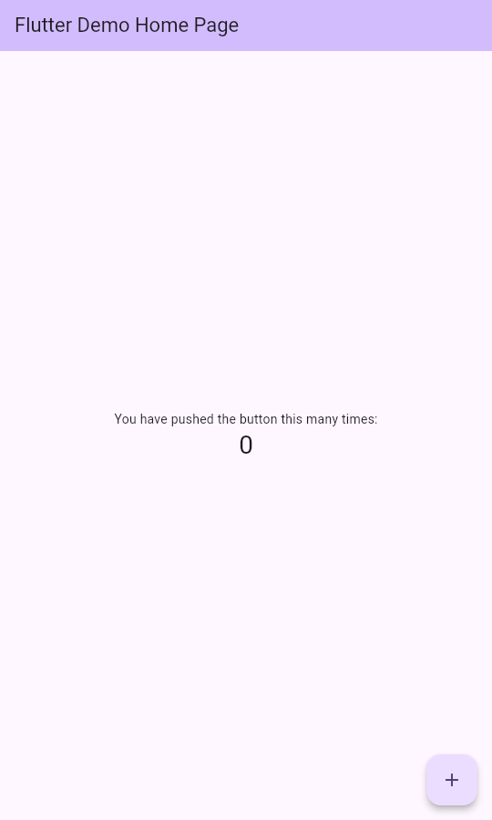

Después reemplacé `main.dart` por mi menú de prácticas:

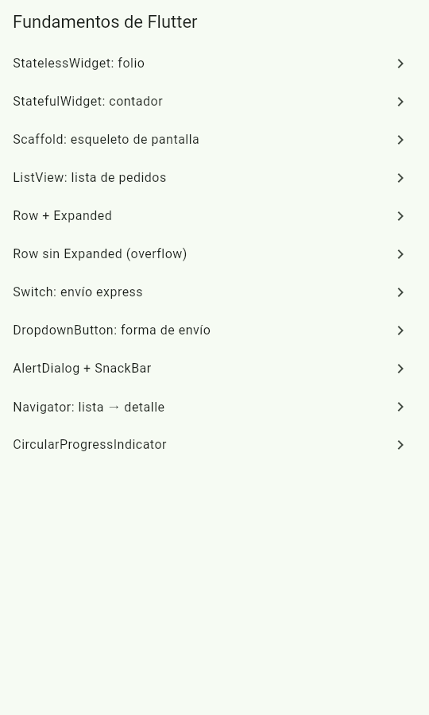

---

## StatelessWidget

`PantallaFolio` recibe el folio por el constructor (`final String folio`) y solo lo dibuja. No tiene `State` ni nada que cambie: si quiero otro folio, quien la crea le tiene que pasar otro valor. Al cambiar el texto en el código y guardar con `flutter run` abierto, se presiona **`r` (hot reload)** y la pantalla se actualiza sin reiniciar la app.

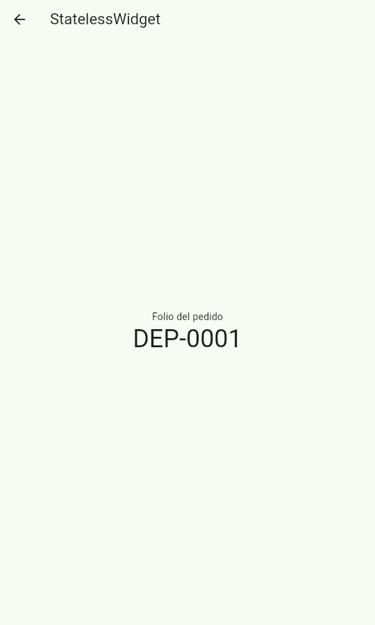

## StatefulWidget

`PantallaContador` guarda `int balones` dentro de su `State`. El botón **Agregar balón** llama a `setState(() => balones++)`, y `setState` es lo que le avisa a Flutter que vuelva a ejecutar `build()`. Si hiciera `balones++` sin `setState`, la variable sí cambiaría, pero la pantalla seguiría mostrando el número viejo.

| Al abrir | Después de 3 toques |
|---|---|
|  | 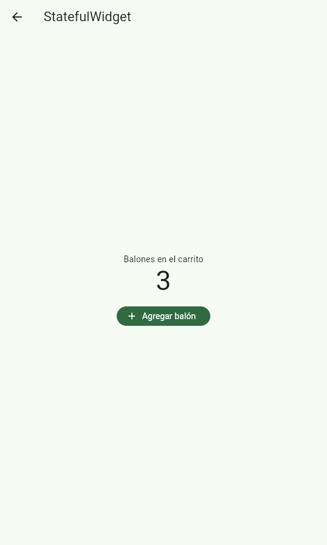 |

La prueba `el contador sube con setState` hace eso mismo de forma automática: toca el botón y verifica que el `0` pase a `1`.

---

## Widgets básicos

### Scaffold (esqueleto de pantalla)

`Scaffold` arma la estructura estándar de una pantalla de Material: `appBar` arriba (con el carrito como acción), `drawer` (menú lateral), `body`, `floatingActionButton` y `bottomNavigationBar` con Catálogo, Pedidos y Cuenta. Cada pieza va en su lugar sin que yo calcule posiciones.

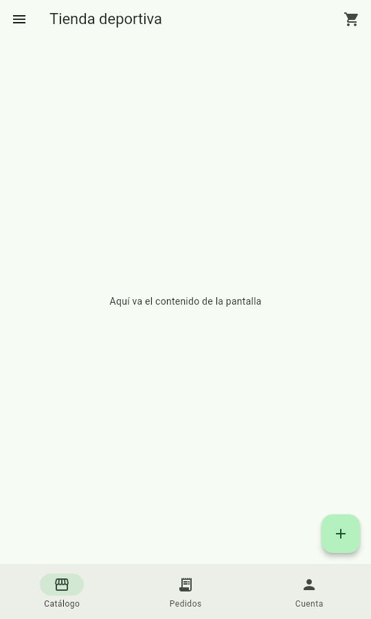

### ListView (lista de pedidos)

`ListView.separated` construye un `ListTile` por cada pedido, con un `Divider` entre ellos. Solo construye las filas visibles, por eso sirve para listas largas con scroll.

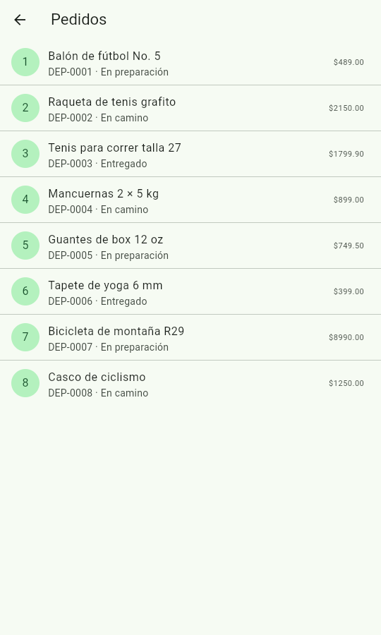

### Row + Expanded

Una fila con ícono, nombre largo del producto y precio.

- **Con `Expanded`**, el texto toma solo el espacio que sobra y hace salto de línea; el precio se queda visible a la derecha.
- **Sin `Expanded`**, el `Text` pide todo el ancho que necesita en una sola línea, que es más que la pantalla, y el precio se sale.

| Con Expanded | Sin Expanded |
|---|---|
| 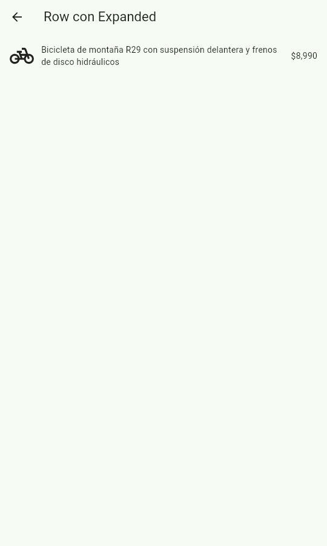 | 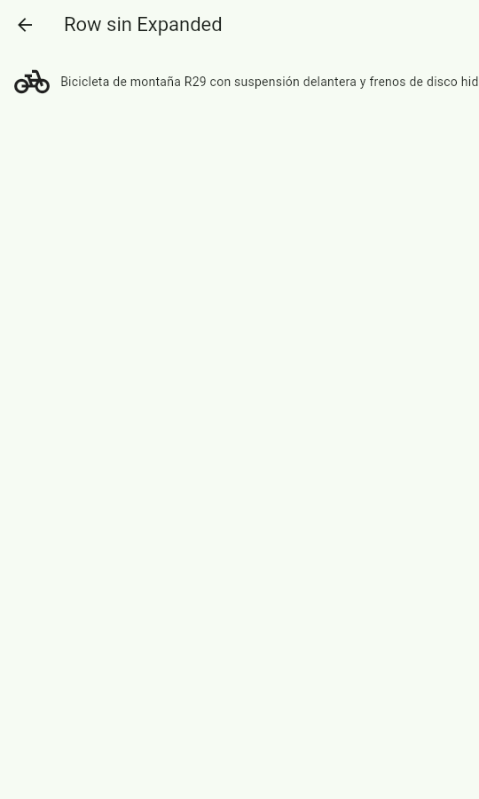 |

En el build de release (la captura) el contenido solo se corta. En modo debug Flutter dibuja la franja amarilla y negra y avisa en la terminal. La prueba `Row sin Expanded desborda y con Expanded no` captura ese error:

```
SIN Expanded -> A RenderFlex overflowed by 767 pixels on the right.
```

Con `Expanded`, la misma prueba confirma que no hay ningún error.

### Switch

`SwitchListTile` para **Envío express**. Al encenderlo, `setState` cambia `express = true` y el costo de envío pasa de $0 a $149.

| Apagado | Encendido |
|---|---|
| 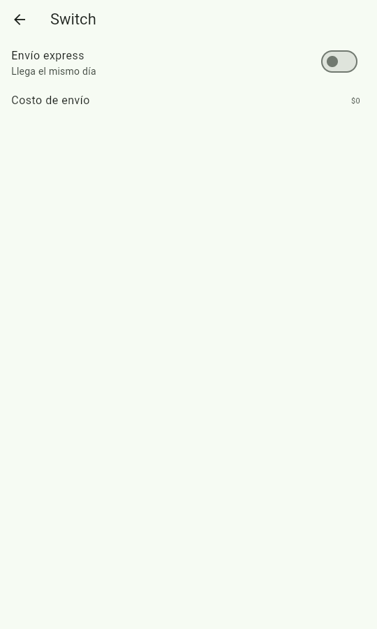 | 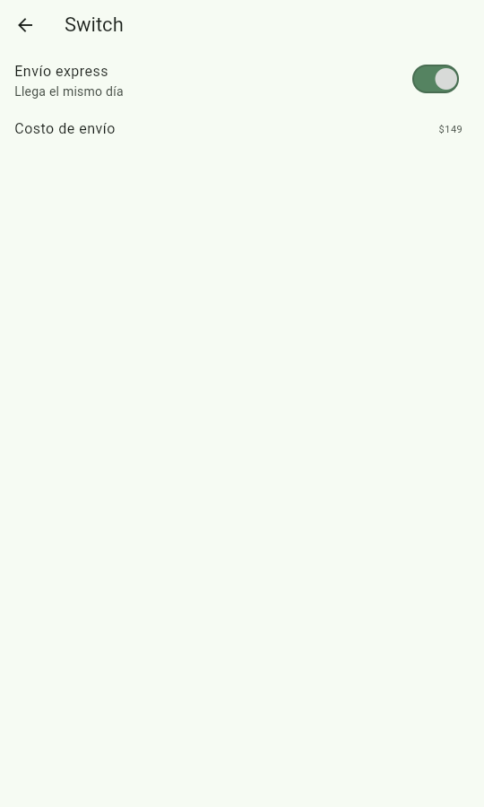 |

### DropdownButton

Lista desplegable con las formas de envío (paquetería estándar, envío express, recoger en tienda). El valor elegido se guarda en el `State` y se muestra debajo.

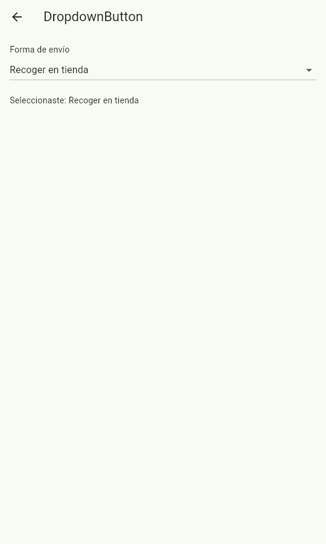

### AlertDialog + SnackBar

El botón **Crear pedido** abre un `AlertDialog` con `showDialog<bool>`. "Cancelar" cierra con `false` y "Confirmar" con `true`. Solo si regresa `true` se muestra un `SnackBar` abajo con "Pedido DEP-0009 creado", sin cambiar de pantalla.

| Botón | Diálogo |
|---|---|
|  | 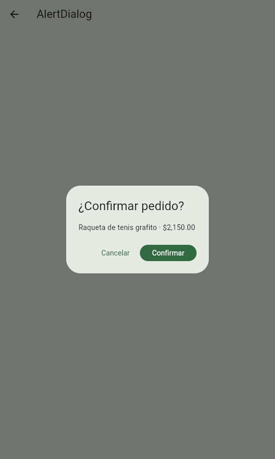 |

### Navigator

`Navigator.push` con `MaterialPageRoute` abre el detalle del pedido tocado. El botón **Volver** (o la flecha del `AppBar`) hace `Navigator.pop` y regresa a la lista. Las pantallas funcionan como una pila: push agrega una encima y pop la quita.

| Lista | Detalle |
|---|---|
| 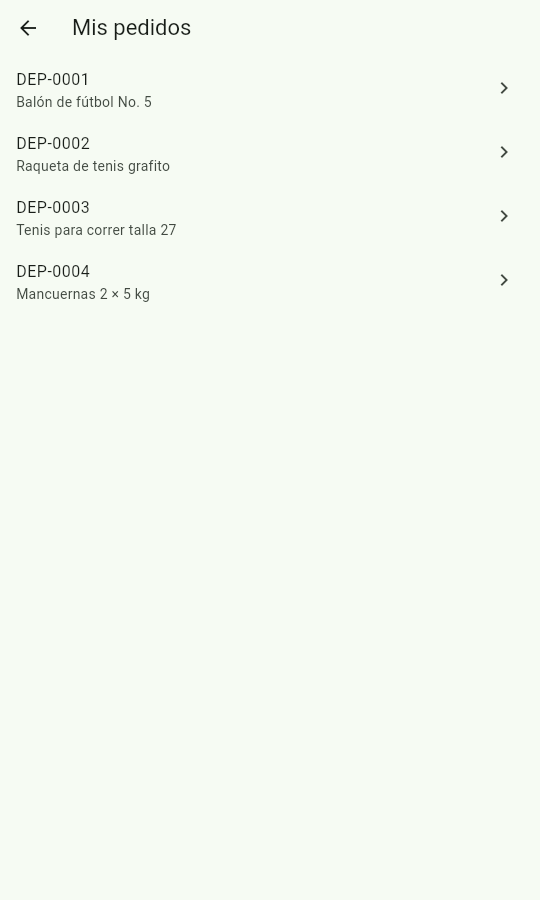 | 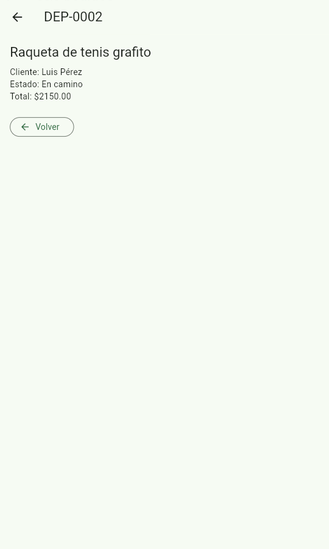 |

### CircularProgressIndicator

`PantallaCarga` simula consultar el estado de un pedido: un `Future` que tarda 2 segundos. `FutureBuilder` muestra el `CircularProgressIndicator` mientras no termina y, al terminar, el resultado con un botón para volver a consultar. Si el `Future` falla, muestra el error.

| Cargando | Resultado |
|---|---|
| 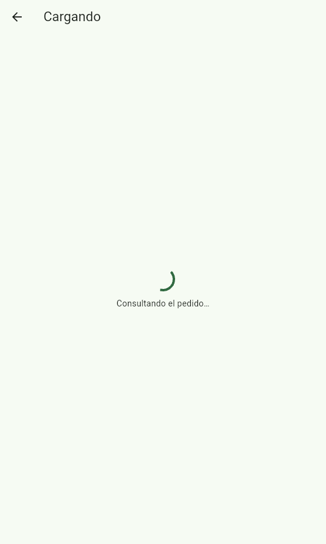 | 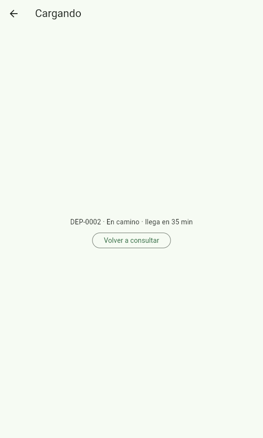 |

---

## Preguntas cortas

**1. ¿Qué problema de mantenimiento ataca Flutter al existir web y móvil en el mismo producto?**
Evita tener dos o tres códigos distintos (web, Android, iOS) que hacen lo mismo. Con apps separadas, cada cambio (un campo nuevo en el pedido, otra regla de validación) se programa y se prueba varias veces, y tarde o temprano las versiones se desfasan. Con Flutter la misma carpeta `lib/` compila a web y a móvil, como esta práctica: el mismo código corre en Chrome y en Windows.

**2. ¿Por qué Flutter dibuja sus propios controles en lugar de usar solo los nativos del sistema?**
Para que la app se vea y se comporte igual en todas las plataformas, y para no depender de lo que ofrezca cada sistema. Flutter pinta cada pixel con su propio motor, así que un `Switch` o un `AlertDialog` salen iguales en Android, iOS y web, y no hay que traducir cada widget al control nativo de cada lugar. El costo es que la app pesa un poco más y no siempre se ve 100% "nativa".

**3. ¿En qué se diferencian un `StatelessWidget` y un `StatefulWidget`?**
El `StatelessWidget` solo dibuja lo que recibe en su constructor y no cambia por sí solo (mi `PantallaFolio`). El `StatefulWidget` tiene un objeto `State` que guarda datos que cambian con el tiempo, y con `setState` se vuelve a dibujar (mi contador de balones, el switch, el dropdown).

**4. Si `flutter doctor` marca un problema en Android pero Chrome funciona, ¿se puede empezar la clase de widgets igual? ¿Qué no se podría hacer todavía?**
Sí, porque los widgets son los mismos y se pueden probar en Chrome (o en Windows, como en mi máquina). Lo que no se podría hacer todavía es correr la app en un emulador o en un celular Android, generar el `.apk` ni probar cosas propias de Android (permisos, red hacia `10.0.2.2`, tamaño de pantalla de teléfono real).

**5. ¿Por qué un `Column` sin `Expanded` a veces «desborda» la pantalla cuando se meten muchos hijos?**
Porque `Column` (igual que `Row`) les da a sus hijos todo el espacio que pidan en su eje, y si la suma de alturas es mayor que la pantalla, no hace scroll ni los encoge: se sale y marca overflow. `Expanded` (o `Flexible`) le dice a un hijo "toma solo el espacio que sobra", y si son muchos elementos, lo correcto es un `ListView`, que sí hace scroll. Lo comprobé con la `Row`: sin `Expanded` se desbordó por 767 pixeles.

**6. ¿Qué widget se usaría para mostrar muchos folios con scroll, y cuál para avisar «pedido creado» sin cambiar de pantalla?**
Para muchos folios, `ListView.builder` o `ListView.separated`, que construye solo las filas visibles. Para avisar "pedido creado", un `SnackBar` con `ScaffoldMessenger.of(context).showSnackBar(...)`, como en mi pantalla de AlertDialog.

**7. ¿En qué se parece el ejemplo de `CircularProgressIndicator` a una llamada real al gateway?**
En las dos se pide algo que tarda y que puede fallar. Mi `Future.delayed` de 2 segundos ocupa el lugar de un `http.post('http://localhost:8080/pedidos')`: mientras no llega la respuesta, `FutureBuilder` muestra el indicador; si llega, se muestra el folio y el medio; si truena (el gateway no responde o regresa error), se va a `snap.hasError` y se muestra el error en vez de dejar la pantalla congelada. Solo cambiaría el contenido del `Future`; la pantalla quedaría igual.
